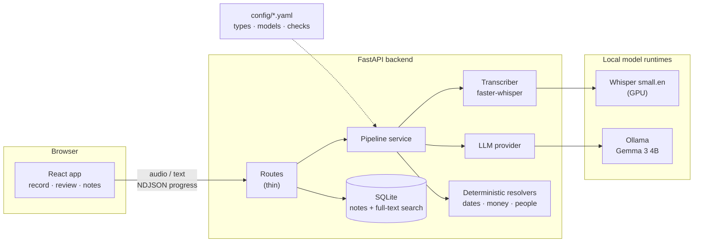
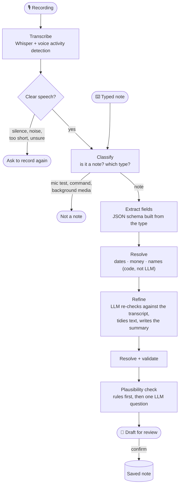
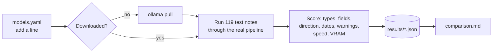
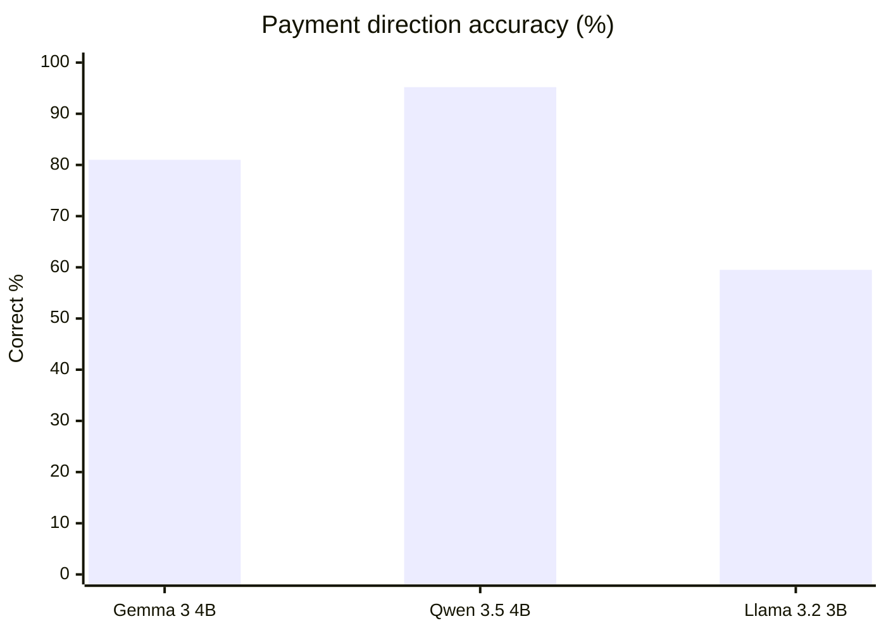
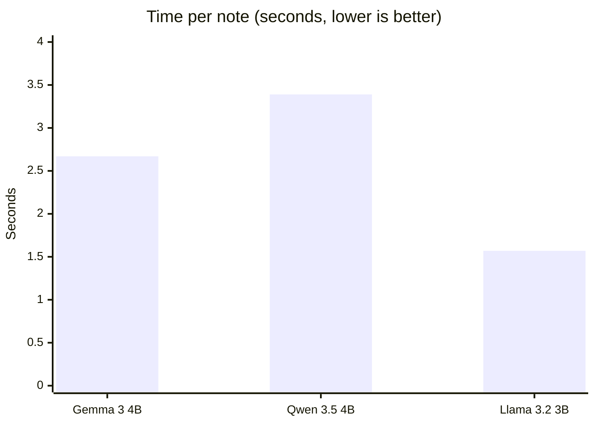

# YapIt

**A private voice notebook that turns what you say into organised notes, entirely on your own computer.**

Tap the mic and say *"Ravi owes me 1.5 lakh for the laptop, he'll pay next Friday."* YapIt writes it
down, works out that it's a **payment**, fills in *Ravi · they owe me · ₹1,50,000 · Fri 30 Oct*,
double-checks it, and shows you a draft to confirm. Nothing leaves your machine: speech
recognition and the language model both run locally on open-weight models.

It's built for people who keep track of small, important things on the go (who owes whom, what you
promised, when things happen), for example a shop owner or freelancer keeping an informal credit
book, where customer details shouldn't sit on someone else's server.

**Stack:** faster-whisper (speech) · Gemma 3 4B via Ollama (understanding) · FastAPI · SQLite ·
React 19 · Vite · Tailwind CSS 4

---

## Contents

- [What it does](#what-it-does)
- [How it works](#how-it-works)
- [Choosing the model: the benchmark](#choosing-the-model-the-benchmark)
- [Setup](#setup)
- [Running the app](#running-the-app)
- [Running the benchmark](#running-the-benchmark)
- [Configuration](#configuration)
- [API](#api)
- [Tests](#tests)
- [Project layout](#project-layout)

---

## What it does

- **Speak or type a note.** Press the mic (or <kbd>Space</kbd>) and talk; live progress shows each step as it happens.
- **Five note types**: payment, promise, event, info and general, each with its own fields. Types are data in a YAML file, not code.
- **Understands Indian usage**: "5k", "1.5 lakh", "2 crore", ₹ grouping like ₹1,50,000, and relative dates like "next Friday", "end of the month" or "in 3 months".
- **Rejects things that aren't notes**: mic tests, "play some music", a YouTube outro picked up in the background.
- **Asks you to re-record** when the audio was silence, noise or too unclear, instead of saving garbage.
- **Warns about unlikely notes**: a wedding 40 years away, ₹50 crore for chai, a 25 PM meeting, 30 February. You can still save it.
- **Review before saving**: a form built from the note type, with missing or suspicious fields highlighted.
- **Today sidebar, searchable notes, edit, and delete with undo.**
- **Works offline** after the first start, and never stores audio.

---

## How it works

### Architecture



Models are swappable by editing `backend/config/models.yaml`; the pipeline only depends on the
`Transcriber` and `LLM` interfaces in `backend/app/providers/base.py`.

### From voice to note



What makes it reliable on a small 4B model:

| Technique | Why |
|---|---|
| **Schema-constrained JSON** on every LLM call, retried once if malformed | the model can only answer in the expected shape |
| **Deterministic resolvers** for dates, money and names | "next Friday" or "1.5 lakh" are computed by code, never guessed by the model |
| **A refine pass** that restates the note in plain words first | catches mistakes like who owes whom |
| **Plain-language choices**: the model picks "I will give the money", not `i_owe_them` | measurably fewer direction mix-ups |
| **Rules before the model** for plausibility (dates years away, huge amounts) | precise, free, and no double warnings |
| **Voice activity detection + hallucination list** | Whisper no longer invents "Thanks for watching!" from silence |
| **Streaming progress** (NDJSON) | the UI shows *Understanding → Filling in details → …* as it happens |

---

## Choosing the model: the benchmark

`benchmark/` compares open models on YapIt's **real pipeline** using 119 held-out test notes
(payment directions, Indian amounts, tricky dates, non-notes, unreasonable notes). It's separate from
the app and never changes it.



### Results (RTX 4060 Laptop, 8 GB)

| | Gemma 3 4B (app default) | Qwen 3.5 4B | Llama 3.2 3B |
|---|---|---|---|
| Classification accuracy | 95.8% | **97.5%** | 85.7% |
| Field accuracy | 94.6% | **96.2%** | 81.5% |
| Payment direction | 81.0% | **95.2%** | 59.5% |
| Amounts | 97.5% | **100%** | 70.0% |
| Dates | **100%** | 90.9% | 95.5% |
| Non-notes rejected | **100%** | 93.8% | 68.8% |
| Unreasonable notes caught / false alarms | 91.7% / 5.6% | **100% / 2.2%** | 91.7% / 6.6% |
| Malformed replies, errors | 0 | 0 | 0 |
| Time per note | 2.67 s | 3.39 s | **1.57 s** |
| GPU memory | 3.9 GB | 3.9 GB | **2.6 GB** |





**Takeaways.** Qwen 3.5 is the most accurate, especially on *who owes whom*, but it sometimes swaps
the speaker's date words for its own guess ("the day after tomorrow" → "Tuesday", wrong) and is
about 0.7 s slower. Gemma 3 is perfect on dates and non-notes, faster, and the app's default. Llama 3.2
is fastest and smallest but too weak on directions and amounts. Small differences (1–2 points)
are within run-to-run noise. Full tables, per category and per pipeline stage, are in
[benchmark/results/comparison.md](benchmark/results/comparison.md).

---

## Setup

**You need:** Ubuntu 22.04/24.04 (or similar Linux), an NVIDIA GPU with 8 GB+ (CPU works, slower),
Python 3.10+, Node.js 20+ (nvm recommended), and about 6 GB of disk for models.

```bash
# 1. Ollama (runs the language model locally) and the default model
curl -fsSL https://ollama.com/install.sh | sh
ollama pull gemma3:4b

# 2. Backend
cd backend
python3 -m venv .venv
.venv/bin/pip install -r requirements.txt
cp .env.example .env          # defaults work for local use

# 3. Frontend
cd ../frontend
nvm use 24                    # or any Node 20+
npm install
```

The first backend start downloads the Whisper speech model once (about 460 MB). After that the app
needs no internet at all.

---

## Running the app

From the repo root:

```bash
./dev.sh            # backend on :8000, then the frontend on :5173
./dev.sh --reload   # also restart the backend when Python code changes (slower: reloads Whisper)
```

Open **http://localhost:5173**. <kbd>Ctrl</kbd>+<kbd>C</kbd> stops both. Before starting, `dev.sh`
checks the virtualenv, `node_modules`, the Node version (switching via nvm if needed), Ollama and
free ports, and if one server crashes it stops the other. API docs are at http://localhost:8000/docs.

---

## Running the benchmark

Uses the backend's virtualenv; no extra setup. Stop `./dev.sh` first for clean timings.

```bash
backend/.venv/bin/python benchmark/run.py
```

That's all: it downloads any model that isn't installed yet, tests every model in
`benchmark/models.yaml` that has no results yet, and updates `benchmark/results/comparison.md`.

**To compare a new model**, add one line to `benchmark/models.yaml` and run the same command:

```yaml
models:
  ...
  phi4-mini: phi4-mini        # id: Ollama tag
```

Thinking models (Qwen 3.5, Gemma 4, …) get thinking switched off automatically, matching how the app
would run them. Other options: `--rerun` (test everything again), `--models <id> …`, `--smoke`
(5 cases, nothing saved), `--compare` (rebuild the report only). Details, and what each score
means, are in [benchmark/README.md](benchmark/README.md).

---

## Configuration

| File | What it controls |
|---|---|
| `backend/config/types.yaml` | Note types: their fields, descriptions and examples |
| `backend/config/models.yaml` | Which speech model and LLM the app uses, their settings, and transcript quality thresholds |
| `backend/config/checks.yaml` | Plausibility thresholds (how far ahead a date may be, largest normal amount per currency) |
| `backend/.env` | Ports, database path, allowed browser origins, upload size limit (see `.env.example`) |
| `frontend/.env` | Backend URL, and optionally the maximum recording length |

**Switching the app's model:** add an entry to `backend/config/models.yaml` and point `active.llm`
at it; no code changes. A different runtime (not Ollama) needs one new provider class in
`backend/app/providers/`.

**Changing a note type:** wording changes (descriptions, examples) apply in place. Adding,
removing or changing fields needs a version bump; old notes keep the definition they were saved with.

---

## API

| Method | Endpoint | Purpose |
|---|---|---|
| `POST` | `/notes/process/stream` | Audio in, NDJSON progress out, then the draft (used by the app) |
| `POST` | `/notes/process-text/stream` | The same for typed text |
| `POST` | `/notes/process`, `/notes/process-text` | Same, without streaming |
| `POST` | `/notes/retype` | Re-read a transcript as a different note type |
| `POST` | `/notes` | Save a confirmed note |
| `GET` | `/notes` | List and filter: `type_name`, `person`, `date_from`, `date_to`, `search` |
| `PATCH` / `DELETE` | `/notes/{id}` | Edit / delete |
| `GET` | `/types`, `/models` | Note type definitions, model registry |

Errors always look like `{"error": "NotANote", "detail": "…"}`. Rejections (`UnclearAudio`,
`NotANote`) also include the `transcript`, so the app can show what it heard.

---

## Tests

```bash
cd backend && .venv/bin/python -m pytest              # app: pipeline, resolvers, API, streaming
cd benchmark && ../backend/.venv/bin/python -m pytest # benchmark: scoring, report, model handling
```

---

## Project layout

```
YapIt/
├── dev.sh                 start backend + frontend together
├── backend/
│   ├── app/
│   │   ├── api/           thin FastAPI routes, error handlers, streaming
│   │   ├── services/      pipeline orchestration, notes, type versions
│   │   ├── pipeline/      classify, extract, refine, resolve, validate, plausibility, prompts
│   │   ├── resolvers/     dates, money, people (deterministic)
│   │   ├── providers/     Whisper and Ollama behind small interfaces
│   │   ├── storage/       SQLite + full-text search
│   │   └── config/        settings and YAML loaders
│   ├── config/            types.yaml, models.yaml, checks.yaml
│   └── tests/
├── frontend/src/
│   ├── pages/             Record (with Today sidebar), Notes
│   ├── components/        review form, note cards, progress steps, dialogs
│   ├── hooks/             recorder, today's notes, delete-with-undo
│   └── api/               the one module that talks to the backend
└── benchmark/             model comparison harness (separate from the app)
    ├── models.yaml        models to compare
    ├── dataset.json       119 held-out test notes
    ├── harness/           scoring, report, Ollama client, runner
    └── results/           per-model runs + comparison.md
```
