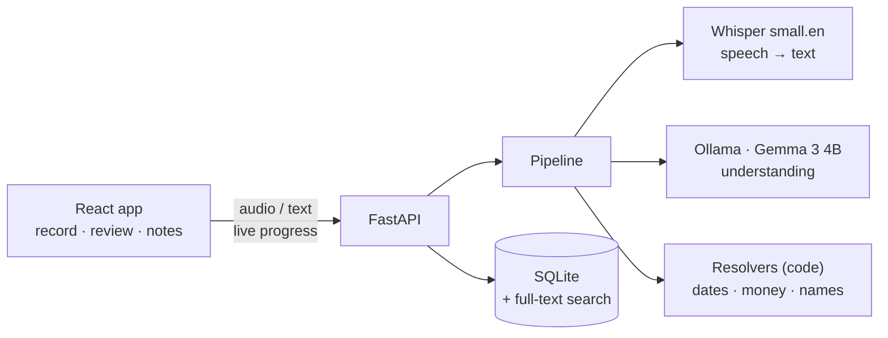
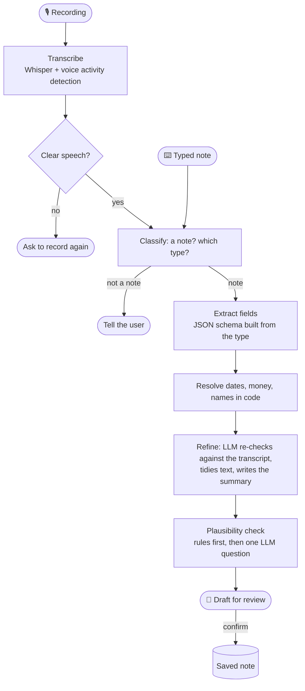
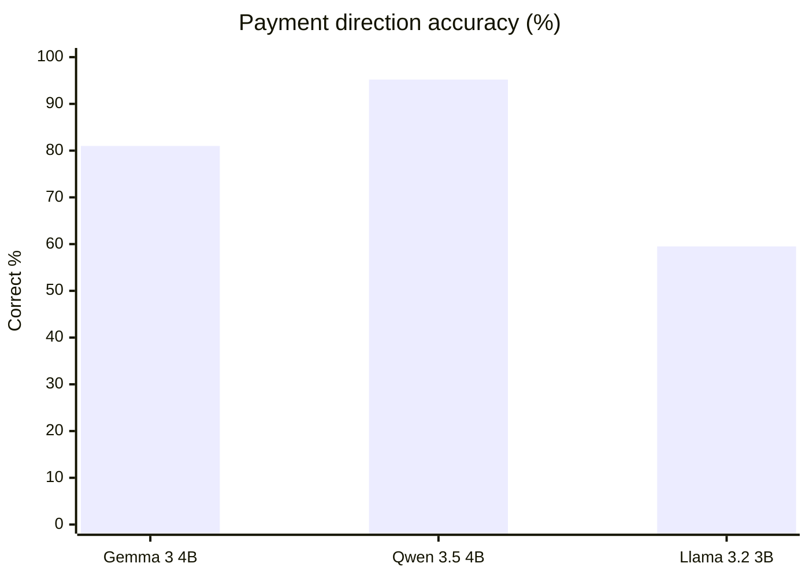
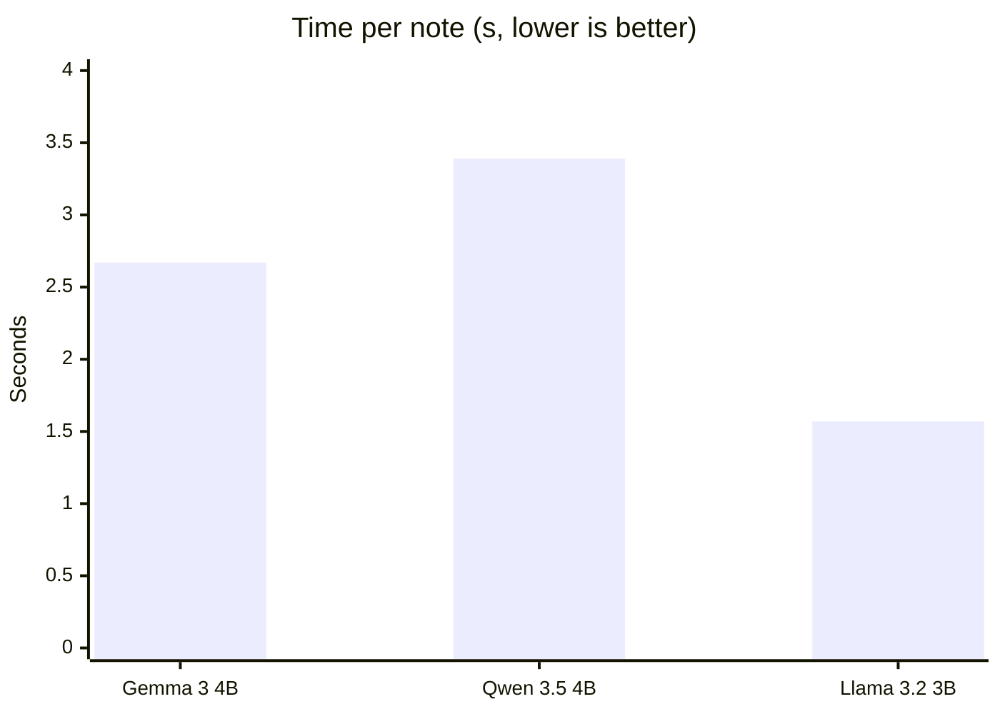
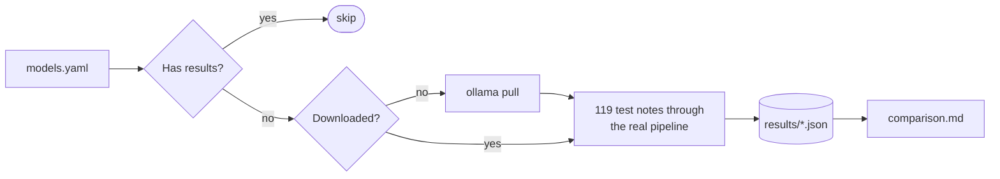

# YapIt

**A private voice notebook: say it, and YapIt turns it into an organised note, entirely on your own computer.**

Speak naturally and YapIt figures out what kind of note it is and fills in the details:

| You say | YapIt saves |
|---|---|
| *"Ravi owes me 1.5 lakh for the laptop, he'll pay next Friday"* | **Payment:** Ravi · owes you · ₹1,50,000 · due Fri 30 Oct |
| *"Physics assignment is due on the 25th, I told Meera I'd share my notes"* | **Promise:** Meera · share notes · due Sun 25 Oct |
| *"Team review with Sunita and Tarun next Wednesday at 2 pm"* | **Event:** Team review · Wed 28 Oct · 2 PM · Sunita, Tarun |
| *"The office Wi-Fi password is brew2026"* | **Info:** Office Wi-Fi password · brew2026 |

You check the draft and save it. Speech recognition and the language model run locally on
open-weight models, so nothing leaves your machine and there's no per-use cost.

**Who it's for:** anyone who thinks of things on the move and wants them captured properly.
- **Students:** deadlines, who borrowed your notes, exam dates.
- **Professionals and freelancers:** meetings, promises to clients, quick facts.
- **Small businesses:** who owes what, and orders and appointments.
- **Everyday life:** splitting bills with friends, birthdays, reminders.

**Stack:** faster-whisper · Gemma 3 4B on Ollama · FastAPI · SQLite · React 19 · Vite · Tailwind CSS 4

---

## Contents

1. [Features](#features)
2. [Quick start](#quick-start)
3. [How it works](#how-it-works)
4. [Design decisions](#design-decisions)
5. [Model benchmark](#model-benchmark)
6. [Configuration](#configuration)
7. [API](#api)
8. [Tests and project layout](#tests-and-project-layout)

---

## Features

- **Speak or type** a note; press the mic or <kbd>Space</kbd>. Live progress shows each step.
- **Five note types** (payment, promise, event, info, general), defined in YAML, not code.
- **Money and dates the way people say them:** "5k", "1.5 lakh", "2 crore", ₹1,50,000, $40, €20; "next Friday", "end of the month", "in 3 months", "the 25th".
- **Rejects non-notes** (mic tests, "play some music", background video) and **asks you to re-record** unclear audio.
- **Warns about unlikely notes** (a wedding 40 years away, a 25 PM meeting, 30 February), but you can still save them.
- **Review before saving**, a **Today** sidebar, search and filters, edit, and **delete with undo**.
- **Offline after the first start.** Audio is never stored.


---

## Quick start

**Needs:** Linux (tested on Ubuntu 24.04), an NVIDIA GPU with 8 GB+ (CPU works, slower),
Python 3.10+, Node.js 20+, and about 6 GB of disk.

```bash
# 1. Ollama and the default model
curl -fsSL https://ollama.com/install.sh | sh
ollama pull gemma3:4b

# 2. Backend
cd backend
python3 -m venv .venv
.venv/bin/pip install -r requirements.txt
cp .env.example .env

# 3. Frontend
cd ../frontend
npm install              # Node 20+ (e.g. `nvm use 24`)

# 4. Run both (from the repo root)
cd ..
./dev.sh
```

Open **http://localhost:5173**. <kbd>Ctrl</kbd>+<kbd>C</kbd> stops everything.

- The first start downloads the Whisper speech model once (about 460 MB); after that no internet is needed.
- No CUDA toolkit install is needed: the GPU library Whisper uses comes with `requirements.txt`. If the GPU can't be used for any reason, YapIt says so in the log at startup and runs Whisper on the CPU instead.
- `dev.sh` checks the virtualenv, Node version (switching via nvm if needed), Ollama and free ports before starting. Use `./dev.sh --reload` to restart the backend on code changes.
- API docs: http://localhost:8000/docs

---

## How it works



Every note goes through the same pipeline:



Every LLM reply is schema-constrained JSON, retried once if malformed. Models can be swapped in
`backend/config/models.yaml`, because the pipeline only depends on two small interfaces
(`Transcriber`, `LLM`). Why each step exists is explained under [Design decisions](#design-decisions).

---

## Design decisions

### Why everything runs locally

- **Privacy:** notes are personal (money, plans, passwords, other people's details) and shouldn't sit on a server you don't control.
- **Zero running cost:** no per-note API bill, so it can be offered cheaply.
- **Works offline,** for example on a train or wherever the internet is patchy.
- **Open models at the core:** they can be benchmarked, swapped with one config line, and fine-tuned for exactly this task.

### Why it's built this way

| Decision | Why |
|---|---|
| **~4B models** | That's what fits in an 8 GB GPU next to Whisper. Bigger models spill onto the CPU and get much slower. |
| **English only, with Whisper `small.en`** | Mainly a time constraint: a Hinglish version was the original idea and is the next big step. For English, the English-only Whisper model is also smaller and more accurate than the multilingual one of the same size. |
| **Gemma 3 4B as the default, for now** | The choice is still open. Qwen 3.5 scored higher overall but was slower and sometimes rewrote dates wrongly; the benchmark is how the default will be decided. |
| **Several small LLM steps instead of one big prompt** | A 4B model does better on one focused job at a time: decide the type, then fill fields, then check. Each step is schema-constrained and timed separately, so failures are visible. |
| **Dates and money computed by code** | Language models are unreliable at calendar maths and at "1.5 lakh". Code is exact, and covered by tests. |
| **A refine pass, with plain-language choices** | Who-owes-whom was the most common error. Making the model first restate the note ("so I will give Neha ₹800"), and choose "I will give the money" instead of `i_owe_them`, took hard phrasings from 4/10 to 8/10 correct. |
| **Rules before the model for plausibility** | Rules catch "40 years away" or "₹50 crore" precisely and for free. The model is asked only when they find nothing, and its prompt was tuned down to 1 false alarm in 53 ordinary notes. |
| **Review before saving** | A small model still makes mistakes, so nothing is saved until you confirm. Warnings never block saving, and deletes can be undone. |
| **Voice activity detection plus a hallucination list** | Without them, Whisper turned silence or background noise into confident nonsense text. |
| **Note types in YAML, with versions** | New types need no code, and old notes keep the definition they were saved with. |
| **A benchmark separate from the app** | Model decisions are based on measurements from a held-out test set, without any risk to the running app. |

### What we deliberately didn't do

| Not done | Why |
|---|---|
| **Cloud LLM APIs** | They would break the privacy, cost and offline goals above. |
| **Storing audio** | It isn't needed once transcribed, and it's the most sensitive data. Each recording is deleted right after transcription. |
| **Auto-correcting mishearings** ("welding" → "wedding") | Tested with the LLM: it fixed only about half, and sometimes changed correct words ("welding rods" → "wedding rods"). Postponed until it can be limited to words Whisper itself was unsure about. |
| **Thinking mode** on Qwen 3.5 / Gemma 4 | The hidden reasoning multiplies the time per note and uses up the reply budget. It's kept off, matching how the app runs; a thinking on vs off benchmark was postponed. |
| **A multiple-choice plausibility prompt, or a second "verify" pass** | Both were measured. Multiple choice raised false alarms to 31 of 40 ordinary notes, and the verifier rejected every warning, real ones included. |
| **Gemma 4 E4B in the benchmark** | Three models from three labs already show the trade-offs. |
| **Hindi / Hinglish** | Planned from the start, but left out of this version for time (see "English only" above). |
| **Accounts, cloud sync, mobile apps** | YapIt is a single-user local tool. These are out of scope. |

---

## Model benchmark

`benchmark/` compares open models on YapIt's **real pipeline**. The models are listed in
`benchmark/models.yaml`, separate from the app's, so benchmarking never changes the app.

### Results

119 held-out test notes on an RTX 4060 Laptop (8 GB):

| | Gemma 3 4B (app default) | Qwen 3.5 4B | Llama 3.2 3B |
|---|---|---|---|
| Classification | 95.8% | **97.5%** | 85.7% |
| Field accuracy | 94.6% | **96.2%** | 81.5% |
| Payment direction | 81.0% | **95.2%** | 59.5% |
| Amounts | 97.5% | **100%** | 70.0% |
| Dates | **100%** | 90.9% | 95.5% |
| Non-notes rejected | **100%** | 93.8% | 68.8% |
| Unlikely notes caught / false alarms | 91.7% / 5.6% | **100% / 2.2%** | 91.7% / 6.6% |
| Time per note | 2.67 s | 3.39 s | **1.57 s** |
| GPU memory | 3.9 GB | 3.9 GB | **2.6 GB** |

None of the models produced a malformed reply or a crashed case.





**Takeaways:**
- **Qwen 3.5 is the most accurate**, especially on who owes whom. But it sometimes replaces the speaker's date words with its own wrong guess ("the day after tomorrow" → "Tuesday"), and it's about 0.7 s slower.
- **Gemma 3 is perfect on dates and non-notes, and faster.** It's the app's default for now, but that choice is still open.
- **Llama 3.2 is fastest but too weak** on directions and amounts.

Differences of 1–2 points are run-to-run noise. Per-category and per-stage tables are in
[benchmark/results/comparison.md](benchmark/results/comparison.md).

### Run it

Stop `./dev.sh` first for clean timings, then from the repo root:

```bash
backend/.venv/bin/python benchmark/run.py
```

That one command downloads any model that isn't installed, tests every model that has no results
yet, and updates `benchmark/results/comparison.md`.



**To compare another model**, add one line to `benchmark/models.yaml` and run the same command:

```yaml
models:
  phi4-mini: phi4-mini    # id: Ollama tag  (optional: label, think, options)
```

Thinking models (Qwen 3.5, Gemma 4, …) run with thinking switched off automatically, as the app
would run them.

| Option | Effect |
|---|---|
| `--rerun` | test every model again (for example after changing the app's prompts) |
| `--models id …` | test only these models |
| `--smoke` | 5 cases per model, nothing saved: a quick check |
| `--compare` | rebuild the report from saved results only |

### The test set and the scores

`benchmark/dataset.json` holds 119 hand-written notes (no real user data), with a fixed capture time,
so dates have one right answer. It's **held out**: never train or tune prompts on it.

| Category | Cases | Probes |
|---|---|---|
| direction | 19 | lent, borrowed, give back, paid for me, … |
| dates | 12 | month names, "in 3 months", "next weekend", "tonight" |
| amounts | 10 | k, lakh, crore, ₹ grouping, dollars and euros |
| non-notes | 16 | assistant commands, mic tests, background video, lyrics |
| unreasonable | 12 | 25 PM, 30 February, 40 years away, ₹50 crore for chai |
| everyday notes | 50 | payments, promises, events, info, general |

What the scores mean:
- **Field accuracy** counts values with one right answer: dates by day, money by amount and currency, times by clock time. Free wording such as titles is scored separately and not counted.
- **Time per note** is the whole pipeline after the model is loaded.
- **GPU memory** is what the model added while running.

Every run is saved with the outcome of each case, and the report recomputes scores from those, so
any number can be traced back to individual notes.

---

## Configuration

| File | Controls |
|---|---|
| `backend/config/models.yaml` | the app's speech model and LLM, their settings, transcript quality thresholds |
| `backend/config/types.yaml` | note types: fields, descriptions, examples |
| `backend/config/checks.yaml` | plausibility limits: how far ahead a date may be, largest normal amount |
| `backend/.env` | ports, database path, allowed browser origins, upload limit (see `.env.example`) |
| `frontend/.env` | backend URL, optional maximum recording length |
| `benchmark/models.yaml` | models to benchmark (doesn't affect the app) |

- **To switch the app's model:** add it to `backend/config/models.yaml`, point `active.llm` at it, and restart. No code changes.
- **To change a note type's fields:** bump its `version`. Saved notes keep the definition they were created with.

---

## API

| Method | Endpoint | Purpose |
|---|---|---|
| `POST` | `/notes/process/stream`, `/notes/process-text/stream` | audio or text in; live progress, then the draft (NDJSON) |
| `POST` | `/notes/process`, `/notes/process-text` | the same, without streaming |
| `POST` | `/notes/retype` | re-read a transcript as another note type |
| `POST` | `/notes` | save a confirmed note |
| `GET` | `/notes` | list; filter by `type_name`, `person`, `date_from`, `date_to`, `search` |
| `PATCH` / `DELETE` | `/notes/{id}` | edit / delete |
| `GET` | `/types`, `/models` | note types, model registry |

Errors always look like `{"error": "NotANote", "detail": "…"}`. Rejections also include the
`transcript`, so the app can show what it heard.

---

## Tests and project layout

```bash
cd backend && .venv/bin/python -m pytest                # app
cd benchmark && ../backend/.venv/bin/python -m pytest   # benchmark
```

```
YapIt/
├── dev.sh             starts backend + frontend
├── backend/
│   ├── app/           api · services · pipeline · resolvers · providers · storage · config
│   ├── config/        models.yaml · types.yaml · checks.yaml
│   └── tests/
├── frontend/src/      pages · components · hooks · api
└── benchmark/         run.py · models.yaml · dataset.json · harness/ · results/ · tests/
```
