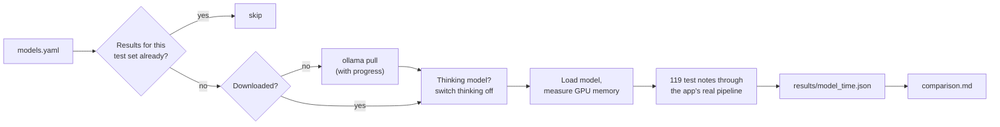

# YapIt model benchmark

Compares open-weight LLMs on YapIt's **real** note pipeline (classify → extract → refine →
plausibility check), using a held-out set of 119 test notes. It answers: *which model should YapIt
run, and what does each one cost in accuracy, speed and memory?*

The benchmark is separate from the app on purpose:

- It never edits app code or config. Candidate models live in `benchmark/models.yaml`, not in the
  app's registry, so the app keeps running whatever `backend/config/models.yaml` says.
- It imports the backend read-only, so it scores exactly the code the app runs.
- It never touches the notes database; only the text pipeline runs (no audio, no saving).

## Run it

From the repo root, with the backend's virtualenv (it already has everything this needs). Make sure
Ollama is running, and stop `./dev.sh` first: app traffic skews timings and VRAM.

```bash
backend/.venv/bin/python benchmark/run.py
```

For every model in `models.yaml` that has no results on the current test set yet, this:



| Option | Does |
|---|---|
| *(none)* | download and test any model without results, then update the report |
| `--rerun` | test every model again (e.g. after changing the app's prompts) |
| `--models id …` | test only these models |
| `--smoke` | first 5 cases per model, nothing saved: a quick sanity check |
| `--compare` | rebuild `comparison.md` from saved results, no models needed |

Each run is saved as `results/<model>_<time>.json` with the outcome of every case, so any score
can be traced back to individual notes. `results/comparison.md` puts the latest run of each model
side by side, with the best value in each row in **bold**. Scores are recomputed from the saved
outcomes, so changing the scoring never needs the models to run again. If `dataset.json` changes,
older results no longer count and those models are tested again.

Tests (no models needed): `cd benchmark && ../backend/.venv/bin/python -m pytest`.

## Adding a model

Add one line to `models.yaml` (`id: Ollama tag`) and run `run.py`:

```yaml
models:
  phi4-mini: phi4-mini
```

Optional longer form: `label` (column name in the report), `think` (force thinking on or off),
and `options` (override the shared `defaults` for this model, e.g. a bigger `num_predict`).
Thinking models are detected from Ollama and run with thinking off unless `think` says otherwise:
hidden reasoning would use up the reply budget and cut the JSON short. The shared `defaults` match
the app's settings, so results reflect how the app would actually behave.

## The test set (`dataset.json`)

119 hand-written, synthetic notes (no real user data), with a fixed capture time
(Saturday 17 Oct 2026, Asia/Kolkata) so relative dates have one right answer. Each case has a
`category`:

| Category | Cases | What it probes |
|---|---|---|
| `direction` | 19 | who owes whom: lent, borrowed, give back, paid for me, … |
| `dates` | 12 | month names, "in 3 months", "next weekend", "tonight", ordinals |
| `amounts` | 10 | k, lakh, crore, Indian digit grouping, dollars and euros |
| `non_note` | 16 | assistant commands, mic tests, background video, lyrics |
| `unreasonable` | 12 | 25 PM, 30 February, 40 years away, ₹50 crore for chai |
| `payment`, `promise`, `event`, `info`, `general`, `ordinary` | 50 | everyday notes |

Expected values are only set where there is one clear right answer (type, direction, amount,
person, dates); wording-dependent fields are mostly left out so rephrasing isn't punished.

**This is a held-out set.** Never train on it or tune prompts against individual cases; the
fine-tuning step must use separate training data, or its improvement would be meaningless.

## What the scores mean

| Score | Meaning |
|---|---|
| Classification accuracy | right note type, or correctly rejected as not a note |
| Non-notes rejected | of the non-notes, how many the gate rejected |
| Real notes wrongly rejected | of the real notes, how many were thrown away as "not a note" |
| Field accuracy | expected values with one right answer that came out right: dates by resolved day, money by amount and currency, times by clock time, people and choices ignoring case |
| Free-text fields, exact wording | titles, topics and other wording the model may phrase differently, matched exactly; informative only, low values are expected |
| Payment direction / Amounts / Dates | the same, for those fields only |
| Warnings caught / False warnings | plausibility warnings on unreasonable notes vs on ordinary ones |
| Malformed LLM replies | replies that weren't valid JSON (each is retried once by the pipeline) |
| Errored cases | cases that crashed; listed by id in the run file |
| Time per note | whole pipeline per note, mean and 95th percentile, after the model is loaded |
| Peak VRAM | GPU memory the model added while running (peak minus the reading before it loaded) |
